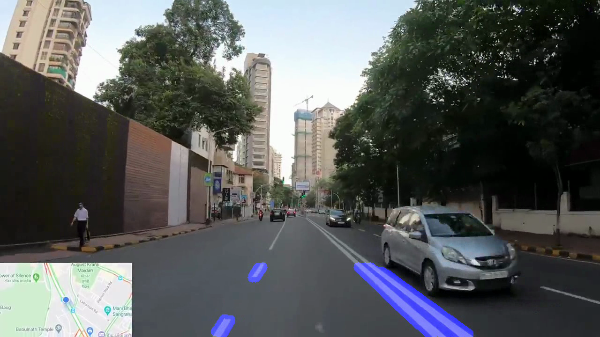
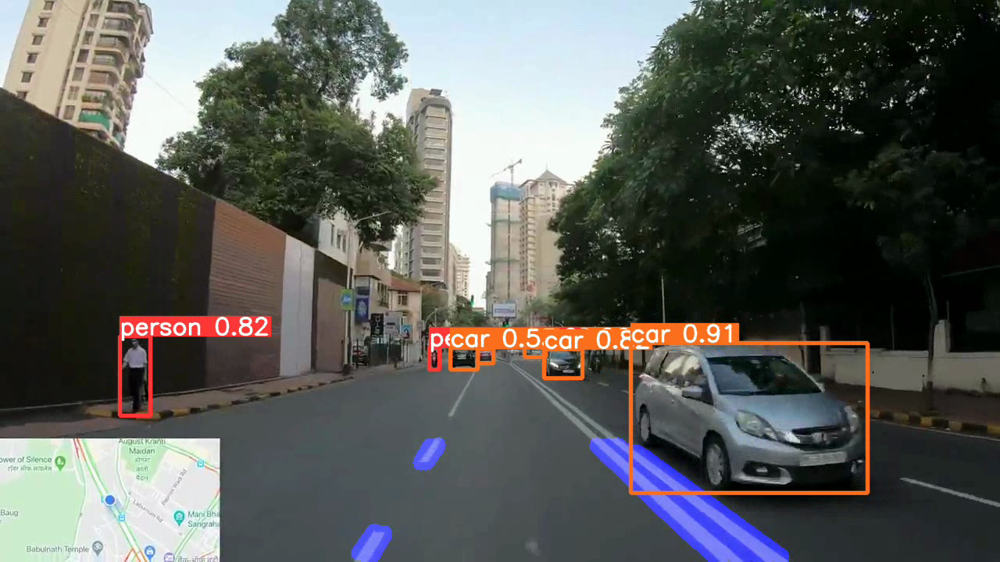

# Road Lane Detection and Object Detection using OpenCV + YOLOv5

A computer-vision demo that processes a recorded road video in two stages: OpenCV highlights candidate lane-line segments, and a pretrained YOLOv5 model detects supported objects such as cars, people, and traffic lights.

> **Scope:** This is an educational prototype for prerecorded video. It is not a safety-certified autonomous-driving system, and its current lane detector is not guaranteed to work on every road or camera view.

## Features

- Grayscale conversion and Canny edge detection
- Region-of-interest (ROI) masking to focus on the road
- Hough Line Transform for candidate lane segments
- YOLOv5 object detection with bounding boxes, class labels, and per-detection confidence scores
- Annotated video output saved locally

## Tech stack

- Python 3.11
- OpenCV and NumPy
- PyTorch and Torchvision
- YOLOv5

## Pipeline

1. `lane.py` reads the configured input clip (`video.m4v`).
2. It applies edge detection, a fixed ROI polygon, and Hough line detection.
3. The lane-marked video is written to `lines.avi`.
4. YOLOv5 processes `lines.avi` and writes an annotated MP4 under `yolov5/runs/detect/`.

## Results

### Lane detection



### YOLOv5 object detection



The labels in the output describe individual predictions. A confidence score such as `car 0.82` is **not** the model's overall accuracy. No formal accuracy benchmark is claimed yet.

## Setup on macOS

### 1. Clone the repository

```bash
git clone https://github.com/piyushnerkarEX/Real-Time-Lane-Detection.git
cd Real-Time-Lane-Detection
```

### 2. Create and activate a virtual environment

```bash
python3.11 -m venv .venv
source .venv/bin/activate
python -m pip install --upgrade pip
```

### 3. Install dependencies

```bash
python -m pip install numpy==1.26.4 opencv-python==4.10.0.84
python -m pip install torch==2.5.1 torchvision==0.20.1
python -m pip install matplotlib pandas PyYAML requests scipy tqdm Pillow seaborn tensorboard thop
```

## Run the project

### Stage 1 — lane detection

```bash
python lane.py
```

This reads the input path configured inside `lane.py` and generates `lines.avi`.

### Stage 2 — object detection

```bash
python yolov5/detect.py --weights yolov5/yolov5s.pt --source lines.avi --view-img --device cpu
```

The annotated video is saved under `yolov5/runs/detect/`. For example:

`yolov5/runs/detect/exp/lines.mp4`

The run folder name can change (for example, `exp2`) on later runs.

## Important limitations

- The input video path in `lane.py` is hard-coded.
- The ROI uses fixed pixel coordinates and may need tuning for a different resolution, camera angle, or road layout.
- Traditional edge/line detection can struggle with curves, faded lane markings, shadows, rain, and low light.
- YOLOv5 can miss or misclassify objects, especially in poor visibility or unusual viewpoints.
- The current workflow processes a recorded video in two stages; live-camera integration and quantitative evaluation are future improvements.

## Future improvements

- Scale the ROI to the actual frame dimensions and make the input path configurable.
- Improve line filtering, lane fitting, and temporal smoothing.
- Test on a varied set of road videos and report measured metrics.
- Add live camera input after validating the prerecorded-video pipeline.

## Credits

This repository is based on [Nirmal-C/Real-Time-Lane-Detection](https://github.com/Nirmal-C/Real-Time-Lane-Detection).

Object detection uses [Ultralytics YOLOv5](https://github.com/ultralytics/yolov5).

Please review the included `LICENSE` file and the upstream YOLOv5 license/terms before redistribution.
